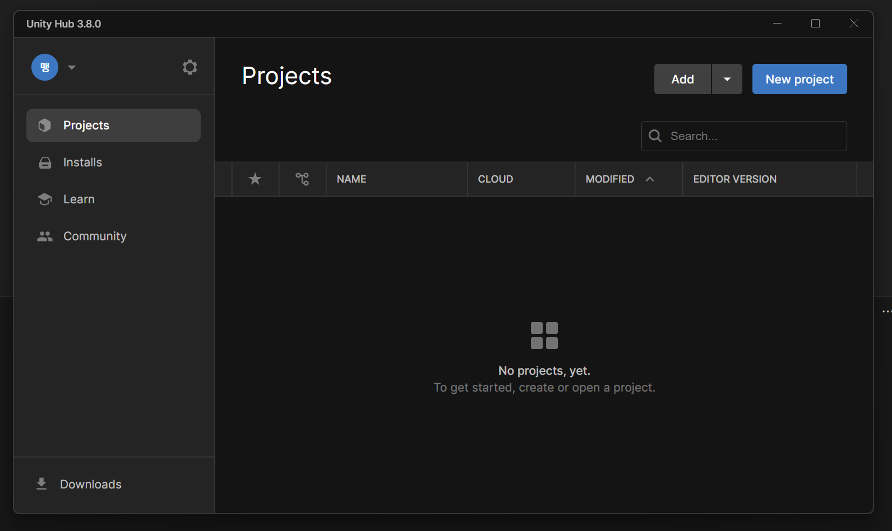
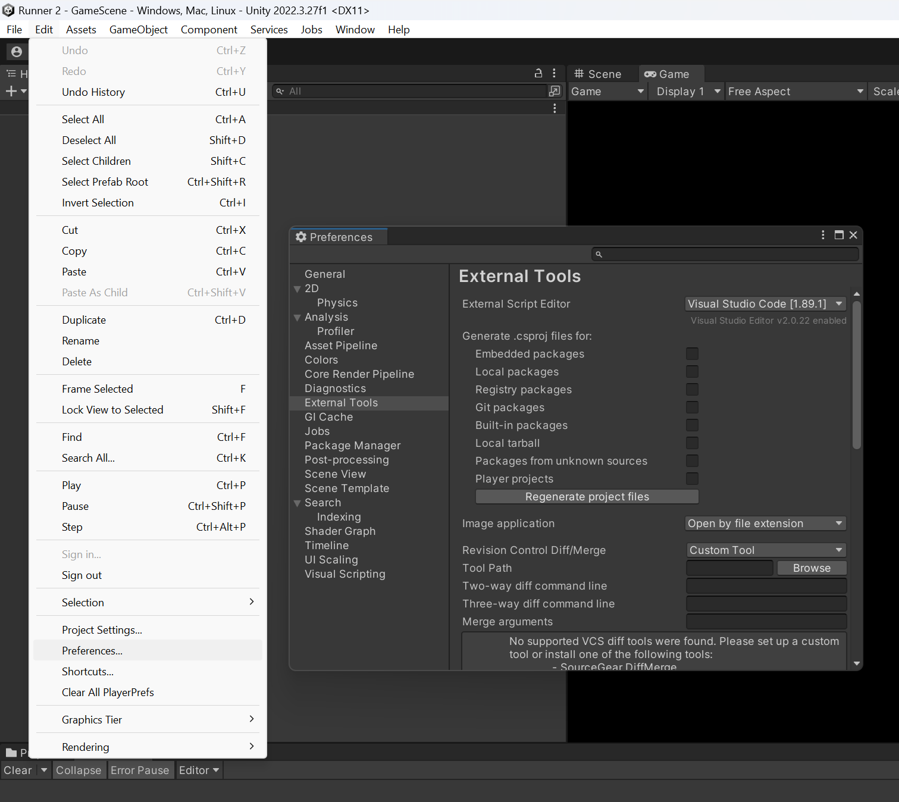

이 글은 독자가 C#/Java나 비슷한 언어와, vscode에 이미 친숙하다고 가정합니다.

## 목차 \{#TOC\}

[TOC]

## Unity Hub 설치 \{#installing-unity-hub\}

우선 유니티는 유니티 허브를 통해 설치합니다.

[유니티 홈페이지](https://unity.com/download)를 통해 다운로드할 수 있습니다.

설치하면 대강 아래 이미지와 비슷한 그림이 나올 것입니다.



## .gitignore 설정 \{#gitignore-settings\}

프로젝트를 생성했다면 Git과 함께 사용하기 위해 기본적으로 .gitignore를 설정해 줘야 합니다.

```gitignore file=../../embed/template/gitignore/unity.txt title=.gitignore
```

대충 이 템플릿을 사용하시면 되겠습니다.

## vscode 설정 \{#vscode-settings\}

vscode로 프로젝트 폴더를 열어보면 C# 코드에서 intellisense가 잘 동작하지 않는 것을 확인할 수 있습니다.



위 스크린샷과 같이 상단 메뉴에서 Edit - Preferences...를 누르면 뜨는 창에서 왼쪽에서 External Tools를 선택하고 External Script Editor를 Visual Studio Code로 선택한 후 Regenerate project file 버튼을 누르면 됩니다.

이후 vscode에서 Reload Window를 하면 C# 코드의 intellisense가 잘 동작하는 것을 확인할 수 있습니다.

이 작업은 Git clone 할 때마다 하면 됩니다.

## 마치며 \{#end\}

유니티 입문 시 정말 유용한데 하나하나 찾아보긴 귀찮은 팁들을 모아봤습니다.

혹시 이 외에도 유니티 입문 시 알면 좋을 팁이 또 있다면 댓글로 공유 부탁드립니다 :smile:
