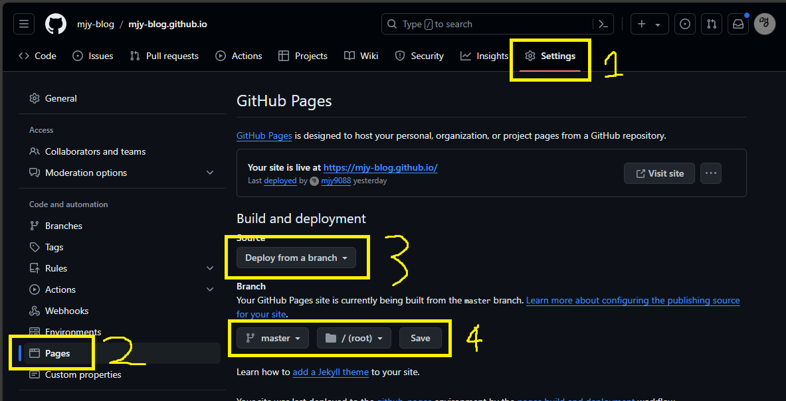

import { DOMAIN } from '../../common/constants/DOMAIN';
import { extractOwnerFromGitHubPagesDomain } from '../../common/util/github/extractOwnerFromGitHubPagesDomain';

Next.js와 GitHub Pages로 블로그를 배포하려는 사람들에게 조금이나마 도움이 되고자 과정을 공유하고자 한다.

## 목차 \{#TOC\}

[TOC]

## Next.js 설정

우선 GitHub Pages에 올릴 수 있도록 static하게 배포하려면 `output`을 `"export"`로 설정해야 한다.

```js title="next.config.js"
// @ts-check

/**
 * @type {import('next').NextConfig}
 */
const nextConfig = {
  output: 'export',
  trailingSlash: true,
};

module.exports = nextConfig;
```

`trailingSlash`는 개인 취향 차이인 것 같은데, 내가 보기에는 true로 설정하는 게 더 좋아보였다.

개발 전반에 걸쳐 큰 영향을 줄 수 있으므로 신중히 결정하자.

`npx next build`로 빌드하면 `out` 폴더가 생긴 것을 확인할 수 있다.

## GitHub Pages 설정

내 경우에는 {DOMAIN}에 배포할 예정이므로 우선 {extractOwnerFromGitHubPagesDomain(DOMAIN)} organization을 만들고, 그 organization에 {DOMAIN}이라는 repository를 만들었다.

`out` 폴더에 `.nojekyll` 파일을 만들고[^1] 모든 파일을 커밋 & push한다.

```shell
cd out
touch .nojekyll
git init
git remote add origin https://github.com/(URL)
git add .
git commit -m "initial commit"
git push origin master --force
```

이후 GitHub에서 다음 설정까지 하면 끝!



[^1]: `.nojekyll` 파일이 없으면 `_next` 폴더가 통째로 무시돼버린다.
