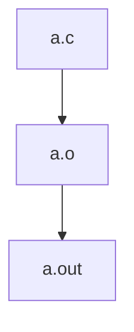
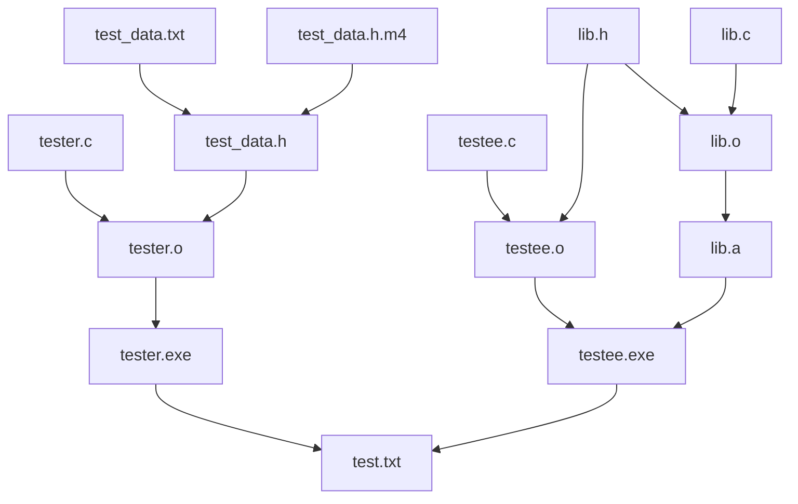

C에 주로 사용되지만 C에 국한되지만은 않는, 빌드 시스템 make에 대해 알아보자

## 목차 \{#TOC\}

[TOC]

## 세 줄 요약 \{#tl-dr\}

- make는 의존성 관리와 증분 빌드 기능을 지원하는 빌드 시스템이다
- 의존성 관리 = 빌드 순서 관리, 증분 빌드: 바뀐 것만 빌드
- make는 원시적인 빌드 시스템이다. 웬만하면 그냥 CMake같은 거 쓰자

근데 문법은 세 줄 요약이 안 되네...

## make \{#make\}

make는 의존성 관리와 증분 빌드 기능을 갖춘 빌드 시스템이다.

일단 이름 그대로 무언가를 만드는 데 사용된다.

### 의존성 관리 \{#dependency-management\}

빌드 과정에서 의존성에 따른 빌드 순서는 무척 중요하다.

`a.c`로 `a.o`를 만들고, `a.o`로 `a.out`을 만드는 상황을 가정하면,

`a.out`을 빌드하기 위해서는 `a.o`가 필요하고, `a.o`를 빌드하기 위해서는 `a.c`가 필요하다.

여기서 `a.out`은 `a.o`에, `a.o`는 `a.c`에 의존성이 있다고 한다.

이 의존 관계를 의존성 그래프로 나타내면 이렇게 된다.



최종적으로 만들고 싶은 파일은 `a.out`이고, 이를 만들기 위해서는...

1. `a.c`를 컴파일해서 `a.o`를 만들고
2. `a.o`를 링킹해서 `a.out`을 만들면 된다.

작업 순서는 의존성 그래프를 위상정렬해서 구할 수 있다.

이 경우에는 의존성 그래프가 무척 간단했지만, 의존성 그래프는 그다지 간단하지 않을 수 있다.



하지만 위상정렬을 통해 간단히 작업 순서를 찾을 수 있다. (순환이 있다면 작업을 완료할 수 없다.)

make는 규칙을 정의하면 그 규칙에서 적절한 작업 순서를 찾아서, 그 순서대로 작업을 수행한다.

이것을 의존성 관리라고 한다.

### 증분 빌드 \{#incremental-build\}

위의 의존성 그래프를 다시 보자.

`testee.c`를 바꾸고 다시 빌드한다면, 뭘 다시 만들어야 할까?

모든 것을 할 필요 없이, `testee.c`에 의존성이 있는 항목만 다시 만들면 된다.
`testee.c` -> `testee.o` -> `testee.exe` -> `test.txt` 순서로.

이렇게 필요한 것만 추려서 다시 만드는 과정은 사람이 하기에는 머리가 아픈 일이다.

make는 규칙을 잘 정의하면 무언가가 변경되었을 때, 변경이 필요한 것들만 다시 만들어준다.

이것을 증분 빌드라고 한다.

### make의 버전 \{#version-of-make\}

make의 규격은 POSIX에서 정의하고 있다.

하지만 대부분 make를 사용한다고 하면 기능이 풍부한 GNU Make를 사용한다.

이 글에서는 GNU Make를 사용하는 것으로 가정하고 GNU Make를 기준으로 설명한다.

POSIX에서 정의한 make와는 조금 다른 부분이 있다.

## Makefile \{#makefile\}

앞선 make 소개에서 규칙을 정의하면 변경이 필요한 것만 만들어 준다고 했었는네,

그 규칙을 Makefile이라는 파일에 정의하게 된다.

Makefile만의 문법이 따로 있어서 그 문법에 맞게 규칙을 정의하게 되는데,

그 규칙은 의존 관계와 그 파일을 만드는 방법으로 나뉜다.

### 규칙 \{#rules\}

아까의 간단한 의존성 그래프를 다시 보자.


여기서 `a.c`는 사람이 직접 만들 파일이다. `a.c`를 만드는 규칙은 필요하지 않디.

이 경우에는 아래의 두 가지 규칙이 필요하다.

1. `a.c`를 컴파일해서 `a.o`를 만드는 규칙
  - 의존성: `a.c`
  - 만드는 방법: `cc -c a.c`
2. `a.o`를 링킹해서 `a.out`을 만드는 규칙
  - 의존성: `a.o`
  - 만드는 방법: `cc a.o -o a.out`

이를 Makefile 문법으로 나타내면 이렇게 된다.

```makefile
a.o: a.c
	cc -c a.c
a.out: a.o
	cc a.o -o a.out
```

우선 `(만들 파일1) (만들 파일2) ...: (의존성1) (의존성2) ...`처럼 의존 관계를 정의하고,

다음 줄부터 만드는 방법을 한 줄씩 **탭으로 들여쓰기** 해서 차례대로 쓰면 된다.

### 변수 \{#variables\}

같은 이름을 여러번 쓰는 것은 좋지 않다.

예를 들어 특정 파일의 이름을 여러 번 쓴다면, 파일 이름이 바뀔 때마다 그 파일 이름을 쓴 모든 곳을 수정해야 하고, 그 중 한 곳이라도 수정하는 것을 잊으면 제대로 동작하지 않을 수 있다.

그럴 때에는 변수를 쓸 수 있다.

변수는 `변수명 = 값`으로 정의하고, `$(변수명)`으로 사용할 수 있다.

```makefile
# 변수 정의
CC = cc
A_C = a.c
A_O = a.o
TARGET = a.out

# 변수 사용
$(A_O): $(A_C)
	$(CC) -c $(A_C)
$(TARGET): $(A_O)
	$(CC) $(A_O) -o $(TARGET)
```

이렇게 변수를 정의해두면 파일명이나 컴파일러가 바뀌어도 그 파일명이나 컴파일러가 쓰인 모든 곳을 바꿀 필요 없이 변수를 정의한 곳만 바꾸면 된다.

### 자동 변수, 패턴 \{#auto-variables-and-patterns\}

위처럼 모든 파일마다 규칙을 만들어야 한다면 Makefile을 쓰더라도 Makefile이 매우 길어질 것이다.

다행히도 _(gnu make에는)_ 규칙에 패턴을 지정할 수 있다.

하지만 패턴에 대해 알아보기 전에 자동 변수를 먼저 간단히 알아보자.

자동 변수는 규칙 안에서 사용할 수 있는, 그때그때 자동으로 만들어지는 변수이다.

`$@`는 만들려는 파일 이름, `$<`는 의존성 중 첫번째, `$^`는 모든 의존성 등… 이 외에도 여러가지가 있다.

```makefile
a.o: a.c
	cc -c $<
a.out: a.o
	cc $^ -o $@
```

이런 자동 변수와 패턴을 결합하면 여러 파일에 대한 규칙을, 규칙 하나로 커버할 수 있다.

```makefile
EXECUTABLE_TARGETS = a.out

%.o: %.c
	cc -c $<
$(EXECUTABLE_TARGETS):
	cc $^ -o $@
a.out: a.o
```

규칙에 `%`가 있으면, 이 `%`에는 무엇이든 들어갈 수 있고, 만들려는 파일의 `%`에 들어간 부분이 의존성의 `%`에도 들어가게 된다.

### .PHONY 규칙 \{#phony-rules\}

무언가를 만들려는 건 아니지만 자주 쓰는 명령어를 make에 alias처럼 등록해서 쓰고 싶을 수 있다.

```makefile
clean:
	rm -f *.o
```

실제로 이런 식으로 등록해서 쓸 수 있지만, 이렇게 쓰는 경우에는 `clean`이라는 파일이 있으면 `make clean`이 아무것도 실행하지 않을 것이다.

그런 문제를 해결하기 위해 `clean`을 가짜를 의미하는 `.PHONY` 타겟으로 지정할 수 있다.

```makefile
.PHONY: clean
clean:
	rm -f *.o
```

이렇게 `clean`을 `.PHONY` 타겟으로 지정하면 `clean`이라는 파일이 있어도 `make clean`이 의도대로 동작한다.

## 마무리 \{#conclusion\}

make는 의존성 관리와 증분 빌드 기능을 갖춘, 무언가를 만드는 데 쓸 수 있는 빌드 시스템이다.

Makefile에 무언가를 만드는 방법을 정의할 수 있다.

이것만 알면 Makefile로 무엇이든 할 수 있...지만, make는 매우 원시적이다.

C나 C++을 위한 거라면, 그냥 CMake 쓰자.
