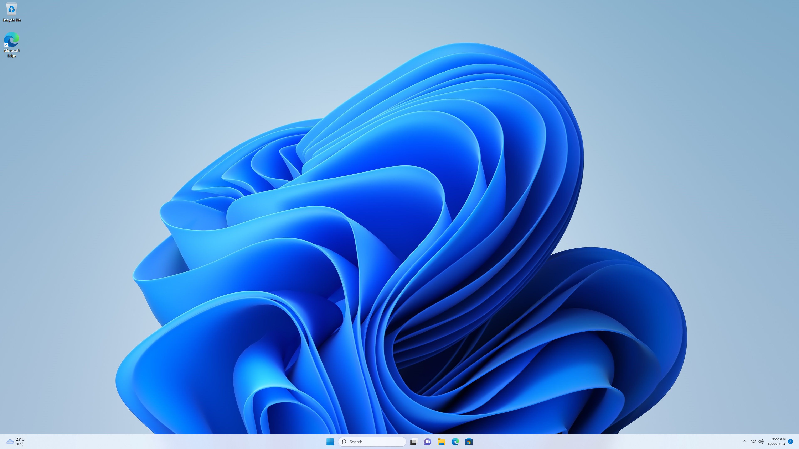
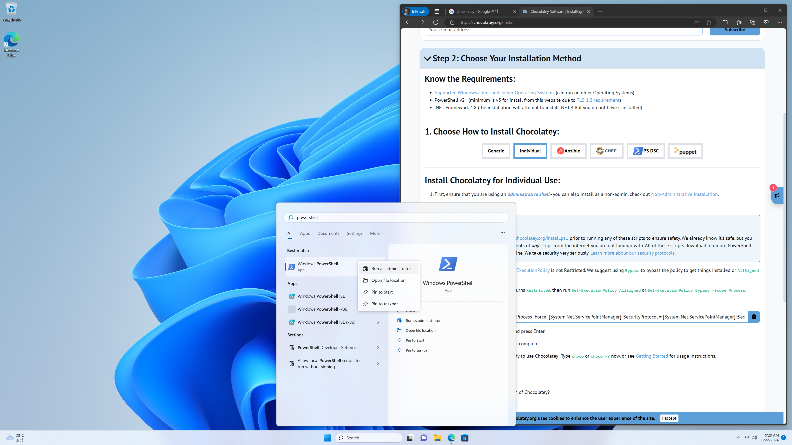
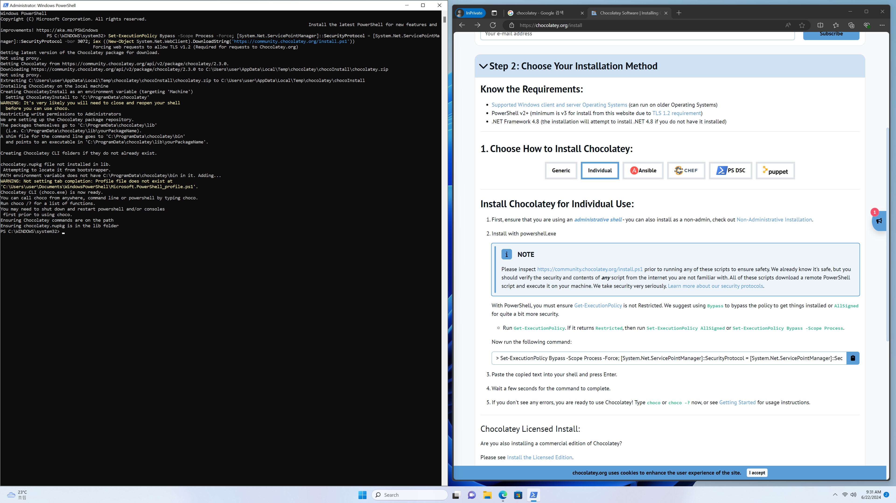
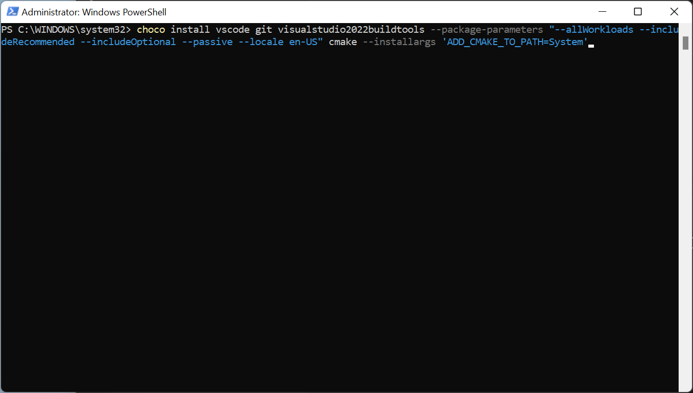
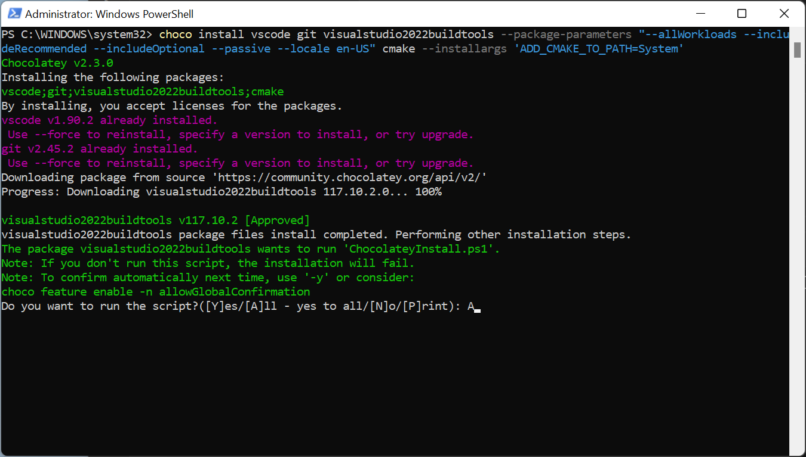
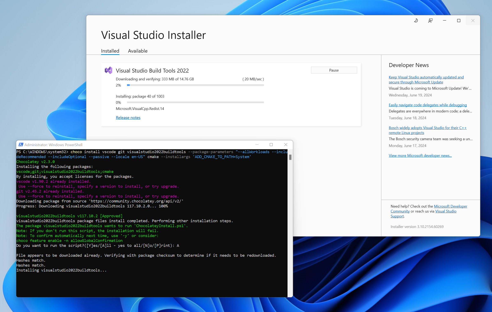
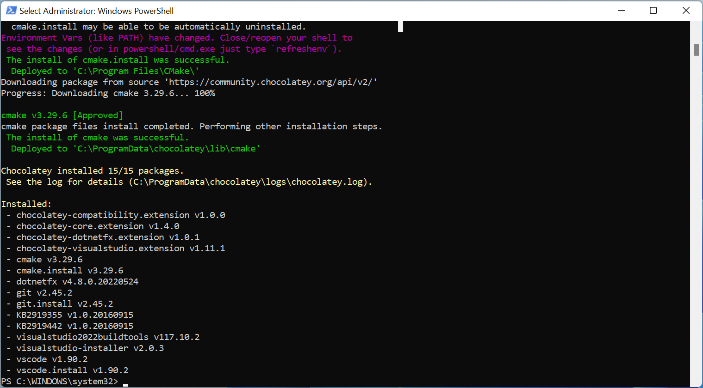
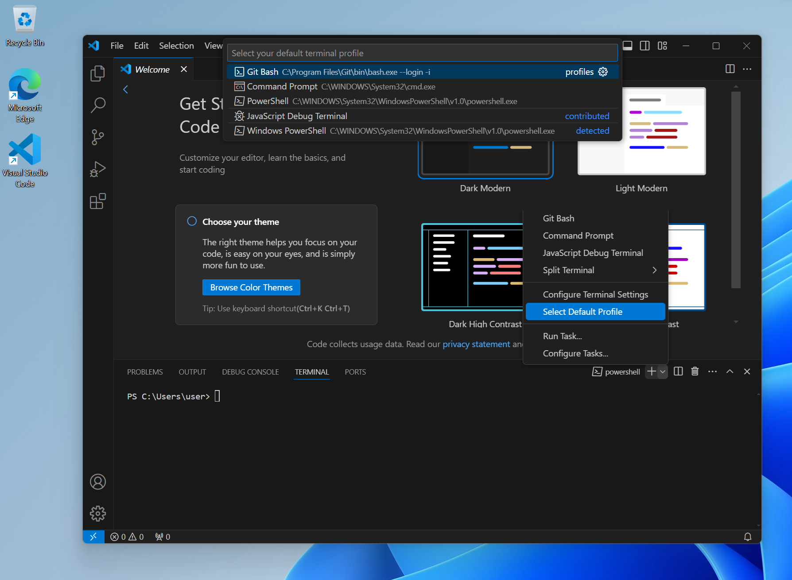
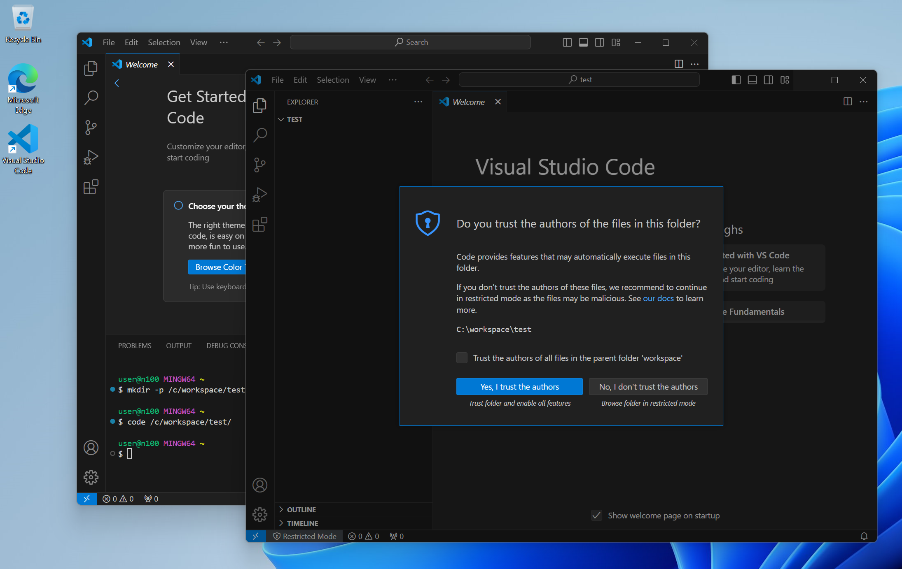
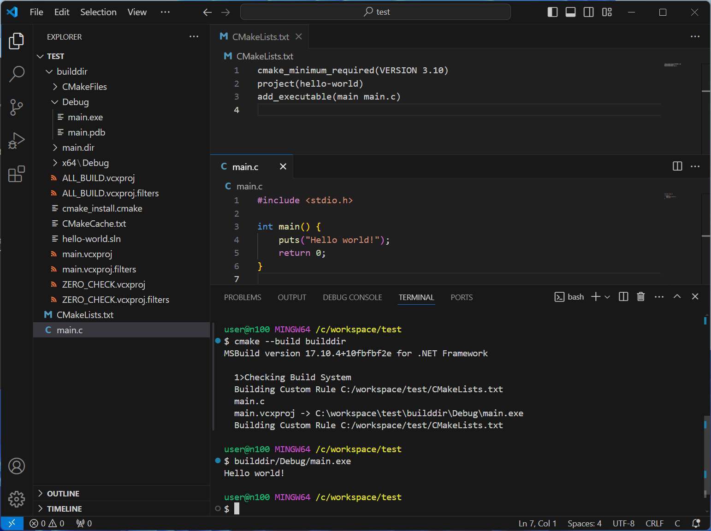

Windows에서 C 개발환경을 설정해보자.

Visual Studio Code, CMake와 Visual Studio Build Tools를 사용할 것이다.

## 목차 \{#TOC\}

[TOC]

## Chocolatey로 패키지 설치

Chocolatey는 패키지 관리자이다. 각종 프로그램을 설치할 수 있다.

[Chocolatey 설치 링크](https://chocolatey.org/install)에서는 파워쉘에서 아래 명령어를 실행해 설치하는 방법을 안내하고 있다.

```powershell
Set-ExecutionPolicy Bypass -Scope Process -Force; [System.Net.ServicePointManager]::SecurityProtocol = [System.Net.ServicePointManager]::SecurityProtocol -bor 3072; iex ((New-Object System.Net.WebClient).DownloadString('https://community.chocolatey.org/install.ps1'))
```



초기 설정을 가정하기 위해 컴퓨터를 초기화 해 봤다.



파워쉘을 관리자 권한으로 실행해서 위 명령어를 입력하면 아래 스크린샷처럼 Chocolatey가 설치된다.



```shell
choco install vscode git
choco install visualstudio2022buildtools --package-parameters "--allWorkloads --includeRecommended --includeOptional --passive --locale en-US"
choco install cmake --installargs 'ADD_CMAKE_TO_PATH=System'
```

이 명령어로 Visual Studio Code, Git, VIsual Studio Build Tools, CMake를 한 번에 설치할 수 있다!

나는 putty, winscp, heidisql, filezilla 등 다른 프로그램도 Chocolatey로 설치했다.



`Do you want to run the script?([Y]es/[A]ll - yes to all/[N]o/[P]rint):`라고 물어보면 A를 입력하면 된다.



Visual Studio Build Tools가 무지 오래 걸린다... 그 동안 간단히 [CMake](/posts/2024-06-18-simple-cmake-guide-for-the-uninterested) 글을 읽고 오자.



설치가 끝나면 아래와 같은 화면이 나타난다.



## Visual Studio Code 설정

우선 Visual Studio Code를 열고 ctrl+\` 또는 ctrl+j로 터미널을 연 후, + 옆의 화살표를 눌러 Select Default Profile을 눌러 Git Bash로 설정해두자. 리눅스나 맥 등의 환경과 호환되는 명령어를 많이 쓸 수 있어 앞으로 도움이 될 것이다.



그럼 기본적인 개발환경 설정은 끝났다.

## 테스트

원하는 곳에 폴더를 만들고 Visual Studio Code로 연다.
(Visual Studio Code에서 ctrl+k, ctrl+o를 순서대로 누르거나 `code <경로>` 명령어 실행)



`Yes, I trust the authors` 버튼을 누르고, 아래 파일들을 만든다.

```cmake title="CMakeLists.txt"
cmake_minimum_required(VERSION 3.10)
project(hello-world)
add_executable(main main.c)
```

```c title="main.c"
#include <stdio.h>

int main() {
    puts("Hello world!");
    return 0;
}
```

이후 터미널에서 `cmake -B builddir`, `cmake --build builddir`를 입력하면



이렇게 잘 실행되는 실행 파일이 생긴 것을 볼 수 있다.
